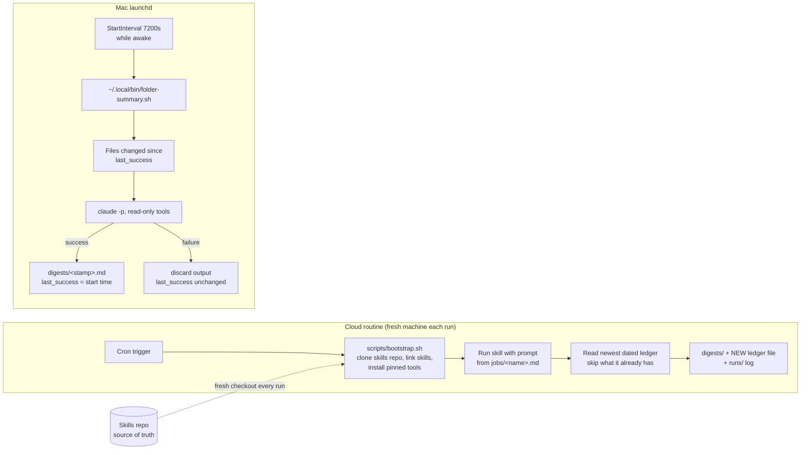

# scheduled-claude-jobs

Run recurring Claude Code jobs on a schedule, either as cloud routines (the laptop can be closed) or under macOS launchd (for jobs that need local files or apps), with skills checked out fresh from a separate repo at every run.

## The problem

I had five recurring AI jobs running on a remote agent service at US$99 a month. It was hard to see what any run did, what it cost, or why it found what it found. Most of the jobs didn't need a dedicated service at all: four of them only called online APIs, and one needed an app that only exists on my Mac.

The obvious fixes each had a catch. Renting a server to keep one desktop app alive costs more than the job is worth. Running everything on the laptop means nothing happens while it is closed. And a fresh cloud machine forgets everything between runs, so a daily job will find, and pay for, the same results every day.

## Approach

Decide the runner by asking what the job needs to touch, not how it uses AI:

| Runner | Use it when | Example job in this repo |
|---|---|---|
| **Claude Code cloud routine** | The job only needs online services. Runs with the laptop closed. | `jobs/weekly-dependency-digest.md`: weekly digest of new releases for a package watchlist, written to a markdown file |
| **Mac launchd** | The job needs local files, a desktop app or its local API. Runs only while the Mac is awake. | `jobs/local-folder-summary.md`: every 2 hours, summarise files changed in a local folder |



The patterns that carry over to any job:

- **One spec file per job.** `jobs/<name>.md` holds the cadence, runner, spend cap and the exact routine prompt. The prompt is the deployment: paste it into the routine and it runs the same way every time.
- **Skills live in their own repo.** `scripts/bootstrap.sh` clones the skills repo (or uses a checkout the routine attached as a second repo), links the named skills into `~/.claude/skills`, and installs their dependencies. Editing a skill changes the next scheduled run with no redeploy here.
- **Since-time state for local jobs.** `last_success` holds the start time of the last run that finished cleanly. Each run covers everything since then, so a run missed while the laptop slept just makes the next digest longer. A failed run leaves it untouched; a dry run never moves it.
- **Dated ledgers for cloud jobs.** A cloud machine has no memory, so each run reads the newest `ledgers/<job>-ledger-<date>.md`, skips what is already in it, and writes the full updated ledger to a new file. Old ledgers are never edited, which also works with storage you can create files in but not overwrite.
- **Read-only by default.** The local job is limited to `Read,Glob,Grep`. Job prompts say what the job must never do (send, post, open PRs). Jobs find, summarise and file; a person decides what to act on.
- **Spend caps per job.** Each job file states a cap per run, enforced in the skill and the paid APIs it calls, and every run log reports what it spent.

## Results

These are the numbers from the original setup, as published in [I moved my AI jobs off a US$99-a-month service. Each run now costs cents.](https://tonytonggg.com/writing/scheduled-ai-jobs-for-cents) The example jobs in this repo are generic stand-ins for those jobs and have no cost data of their own.

- **Before:** US$99 a month for a remote agent service running five recurring jobs.
- **After:** 4 jobs as cloud routines plus 1 on the laptop under launchd, rebuilt in one afternoon. The schedule is included in the existing AI subscription; what each run pays for is data.
- **First test runs (data cost per run):**

| Job | How often | Cap per run | First test run |
|---|---|---|---|
| Weekly research job | Weekly | $0.50 | $0.30 |
| Daily lead finder | Daily | $0.50 | $0.36 |
| Second daily lead finder | Daily | $0.75 | $0.16 |
| Weekly content-research job | Weekly | $1.20 | still running at the time of writing |

- If every job hit its cap on every run, data would cost about $45 a month. The first runs came in at roughly half their caps.
- These are single runs, not a track record. One job found nothing, which is the correct output when nothing qualifies.

## Quickstart

Requires macOS (launchd, BSD `date`), bash and git. Nothing here calls Claude or the network.

```bash
git clone <this repo> && cd scheduled-claude-jobs
bash tests/run.sh
```

Expected: `25 passed, 0 failed` (shellcheck runs if installed: `brew install shellcheck`). The tests use a temp dir, a **synthetic** skills repo (`examples/skills-repo/`) and synthetic files. They cover the bootstrap checkout (attached and cloned), the rendered launchd plist, and the since-time logic: dry run, success with a fake `claude`, failure leaving `last_success` alone, and the next run covering only the new window.

Try the local job without calling Claude:

```bash
mkdir -p /tmp/watch && echo "TODO: finish onboarding checklist" > /tmp/watch/onboarding.md
DRY_RUN=1 WATCH_DIR=/tmp/watch STATE_DIR=/tmp/fs-state bash local/folder-summary.sh
cat /tmp/fs-state/digests/*.md     # the changed files and the exact prompt it would send
```

To run it for real, install Claude Code, then:

```bash
WATCH_DIR="$HOME/notes" bash local/install.sh          # copies the script to ~/.local/bin, loads the LaunchAgent
launchctl kickstart -k gui/$(id -u)/com.example.folder-summary
ls ~/.local/state/scheduled-claude-jobs/folder-summary/{digests,logs}
```

`bash local/install.sh --print` renders the plist without installing anything.

To set up the cloud job: create a routine in Claude Code, attach this repo, add `SKILLS_REPO_URL` (and `SKILLS_REPO_TOKEN` for a private repo) to its environment, paste the prompt from `jobs/weekly-dependency-digest.md`, and run it once by hand before turning the schedule on. `.env.example` lists the variables; it holds placeholders only.

## Repo layout

```
jobs/                     one spec per job: cadence, runner, cap, routine prompt
  weekly-dependency-digest.md         cloud routine example (+ synthetic watchlist)
  local-folder-summary.md             launchd example
scripts/bootstrap.sh      first step of every routine: fresh skills checkout, link, install deps
local/
  folder-summary.sh       the launchd job (since-time state, DRY_RUN, read-only tools)
  com.example.folder-summary.plist    LaunchAgent template
  install.sh              installs the script to ~/.local/bin and loads the LaunchAgent
examples/skills-repo/     synthetic stand-in for your skills repo (skills/<name>/SKILL.md)
digests/ ledgers/ runs/   where cloud job outputs, ledgers and run logs are committed
tests/run.sh              offline tests
```

## Design decisions

- **launchd can't read `~/Desktop`.** macOS privacy rules block launchd jobs from `~/Desktop`, `~/Documents` and `~/Downloads` unless you grant Full Disk Access. Repos often live on the Desktop, so `install.sh` copies the script to `~/.local/bin` and the plist points there. Re-run the installer after editing the script. The installer warns if `WATCH_DIR` is in one of those folders.
- **Since-time, not "last 24 hours".** A fixed window either misses things after a sleep or repeats them after a short gap. Moving `last_success` only on success makes runs safe to miss and safe to retry.
- **Pin versions in bootstrap.** The cloud image's default language versions are not the ones you tested with. One tool in the original setup needed a newer Python than the cloud machine had, and installs failed until the version was pinned.
- **Expect a locked-down network.** Cloud routines can only reach an allowlist of sites. Add each API host by name before the first run, or every call comes back blocked.
- **Secrets come from the routine's environment.** Skills that read a local `.env` file on the laptop must read environment variables in the cloud.
- **Every output ends in `.md`.** Reports saved without a file ending didn't show up in the notes app. Checking the first run's ledger caught it.
- **Run once by hand, read the whole log, then schedule.** Every job in the original setup was checked this way before its schedule was switched on.

What I'd do next: a small runner that reads each job file's cap and cadence and fails a run that reports spend over its cap; a weekly roll-up of `runs/` logs into one cost table; and a `launchd` health check that alerts when `last_success` is older than a few intervals.

## Article

[I moved my AI jobs off a US$99-a-month service. Each run now costs cents.](https://tonytonggg.com/writing/scheduled-ai-jobs-for-cents)

## Licence

MIT, see [LICENSE](LICENSE).
